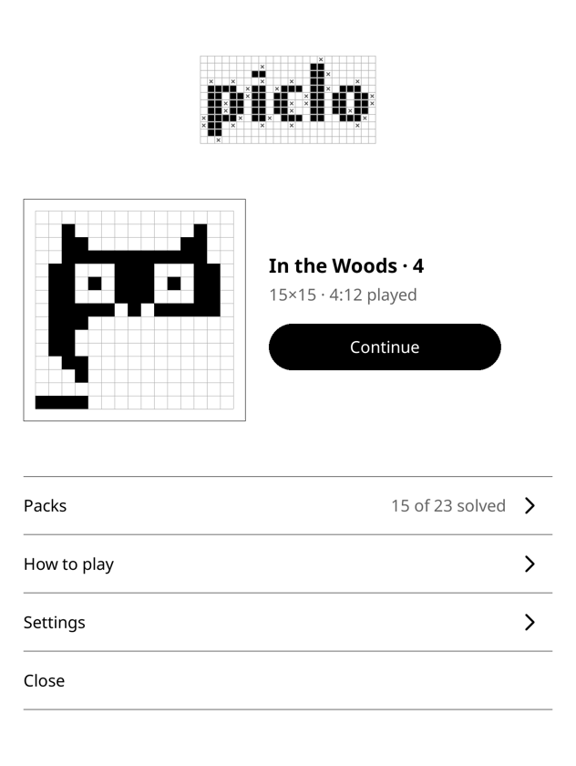
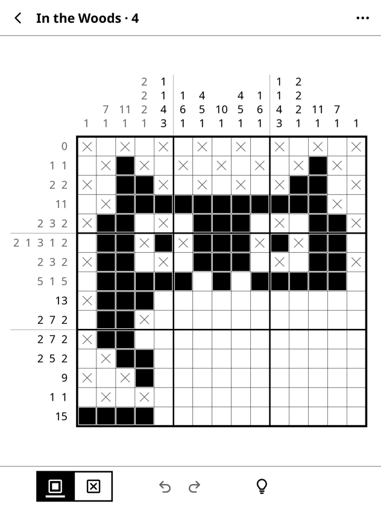
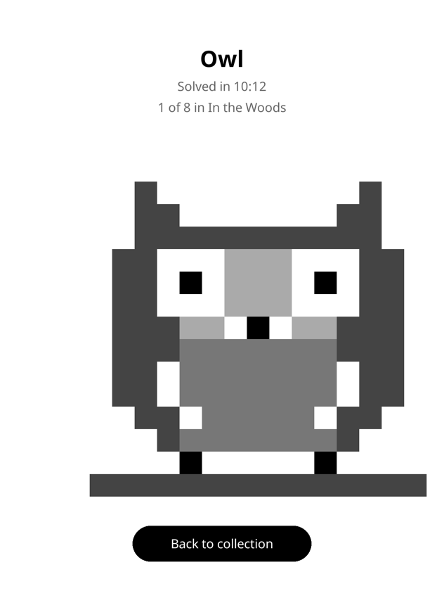
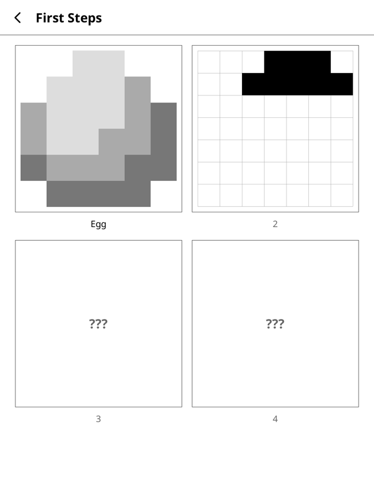

# Piclo

Picture logic puzzles for KOReader. Fill in squares by the numbers, and a
hand-drawn picture appears when you finish.

<p>
  
  
  
  
</p>

Piclo is made for e-ink. Every screen is grayscale, nothing animates, and only
the squares you touch are redrawn. You can play a few lines while waiting
for the kettle and pick up where you left off, even after a restart.

- **23 puzzles in three packs.** First Steps (6×6 to 8×8) tells a small story,
  Around the House (10×10) has everyday objects, and In the Woods (15×15)
  is the hardest. Each pack unlocks the next.
- **Every puzzle has one answer** that you can work out line by line, so you
  never have to guess.
- **The reveal.** When the last square is right, a shaded picture appears on
  the grid you just solved and joins your collection.
- **How to play and two guided practice puzzles** for anyone new to this kind
  of puzzle.
- **Help when you need it.** Hints fill in the next line that can be worked out
  and highlight its numbers, with undo and redo for every move.
  Mistake checking is optional: off, on request, or as you play.
- **Fits your device.** Portrait and landscape, page-turn buttons to switch
  between Fill and Cross, night mode, and a choice of what holding a square
  does.
- English, Dutch, German and French.

## Install

1. Download `piclo.koplugin.zip` from the
   [latest release](https://github.com/jipsierksma/piclo.koplugin/releases/latest).
2. Unzip it into KOReader's `plugins` folder, so you end up with
   `koreader/plugins/piclo.koplugin/`. On a Kindle that's the `koreader`
   folder at the root of the USB drive.
3. Restart KOReader.

With the [AppStore plugin](https://github.com/omer-faruq/appstore.koplugin)
you can install and update Piclo from inside KOReader instead.

Updating: replace the `piclo.koplugin` folder. Your progress is kept in
`koreader/settings/piclo.lua`. If you have a `piclogic.koplugin` folder from
an early test version, delete it.

Piclo needs a touch screen. On devices without one it doesn't show up.

## Where to find it

Open the top menu (tap the top of the screen), go to the Tools tab (the
wrench icon) and choose **Piclo puzzles**. KOReader adds plugins to the end
of that list, so it's on the last page.

To open it in one go, bind it to a gesture: in the top menu go to Settings
(the gear icon) → Taps and gestures → Gesture manager, pick a gesture, then
General → Piclo puzzles. Home-screen plugins that launch actions can open it
the same way.

## Adding puzzles

Puzzles live in `piclo/data/packs/`, one file per pack, listed in order in
`index.lua`. A pack is plain Lua data:

```lua
return {
    id = "house",
    title = _("Around the House"),
    license = "CC-BY-4.0",
    credit = "Jip Sierksma",
    -- Optional: locked until 3 puzzles of First Steps are solved.
    unlock = { pack = "starter", count = 3 },
    puzzles = {
        {
            id = "house/toaster",
            title = _("Toaster"),
            art = {
                ".222.222..",
                ".433.433..",
                -- one string per row
            },
        },
    },
}
```

In `art`, a `.` is an empty square and a digit is a filled one; the digit is
its tone in the reveal, from `0` (black) to `4` (lightest). See
[docs/ART_STYLE.md](docs/ART_STYLE.md). Puzzles can be up to 15×15 and must
not need guessing: `make validate` checks that each one solves by line logic
alone and is centered. Ids must never change once released, because saved
progress uses them.

## Development

Piclo is plain Lua for KOReader's LuaJIT, with no dependencies.

| Command | What it does |
|---|---|
| `make test` | Unit and headless UI specs (`spec/`), with KOReader stand-ins |
| `make validate` | Every puzzle solvable by line logic, centered and credited |
| `make lint` | luacheck |
| `make pot` | Collects strings into `l10n/piclo.pot` and updates each language |
| `make dist` | Tests, validates and builds `piclo.koplugin.zip` |

`docs/MANUAL_TEST.md` is the checklist for a release on a real device.

Translations are standard `.po` files in `l10n/<language>/piclo.po`. To add
a language, copy `l10n/piclo.pot` to `l10n/<code>/piclo.po` (e.g. `es`) and
translate it.

## Credits and licenses

Made by Jip Sierksma.

The code is licensed under the [GNU Affero General Public License v3.0](LICENSE).
The puzzle pictures are original and licensed under
[CC BY 4.0](https://creativecommons.org/licenses/by/4.0/); see
[CREDITS.md](CREDITS.md).
